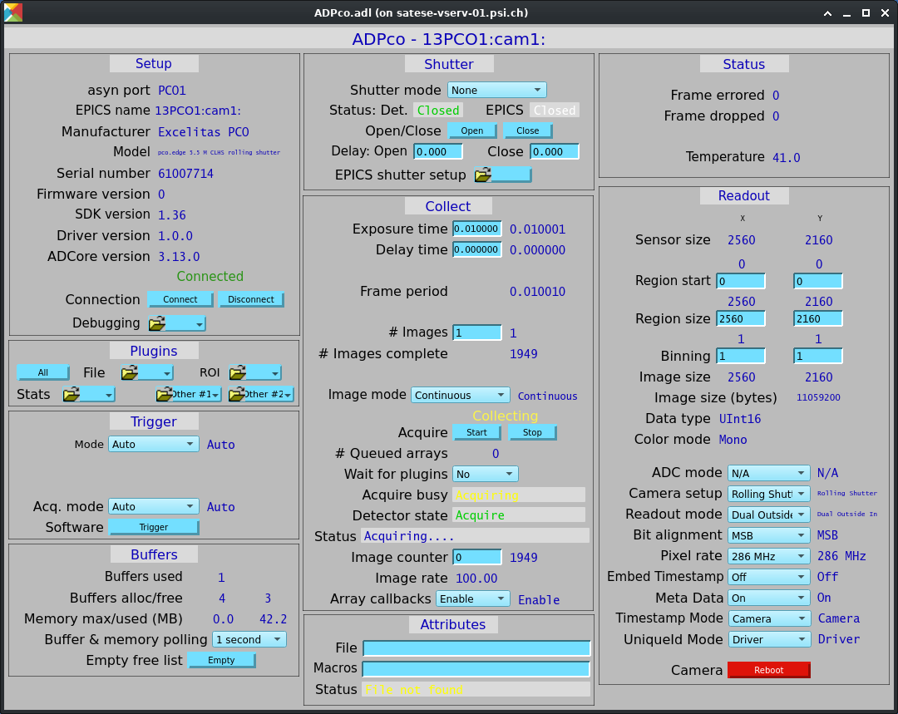

=====
ADPco
=====

:author: Xiaoqiang Wang, Paul Scherrer Institute

.. contents:: Contents

.. _Excelitas:    https://www.excelitas.com
.. _pco.edge:     https://www.excelitas.com/product-category/pcoedge-cooled-scmos-cameras
.. _pco.sdk:      https://www.excelitas.com/product/pco-software-development-kits#custom-tab-general-sdk
.. _frame grabber drivers: https://www.excelitas.com/product/pco-interface-drivers#custom-tab-clhs

Overview
--------

ADPco uses Excelitas_ pco.sdk_. It has been tested on both Windows and Linux, although
it is mainly used on Linux. It has been tested only with pco.edge_ 5.5 and 10 bi CLHS cameras, with
Silicon Software microEnable 5 marathon AF2/VF2 cameralink HS frame grabber and KAYA Komodo I/II CLHS
frame grabbers.
It may work with other pco cameras, but feathers may be missing. E.g. it does not support
acquire to and read from camera internal memory.

The header files and Windows import libraries are include, so it is ready to build for Windows.

For Linux, the pco.sdk is provided by vendor as debian and RPM packages.
The header files and libraries are located in /opt/pco/pco.sdk. For other systems,
it is simplest to install it on a debian or RPM-based system and copy files over.

The `frame grabber drivers`_ are available from Excelitas. Some notes:

* For Silicon Software driver, a normal user needs to be added to the "video" group to access the device.
* For KAYA driver, the VisionPoint libraries are prebuilt for recent Ubuntu LTS. **libKYFGLib.so**
  requires system opencv_core/imgcodecs/imgproc/videoio libraries. For other systems,
  symbolic links to your system opencv libraraies might work.

Define this in the areaDetector top level CONFIG_SITE.local file,::

  WITH_PCO = YES
  PCO_INCLUDE = /opt/pco/pco.sdk/include
  PCO_LIB = /opt/pco/pco.sdk/lib

ADPco driver
------------
ADPco inherits from ADDriver.  It adds the following parameters and EPICS records that are
specific to ADPco.

.. cssclass:: table-bordered table-striped table-hover
.. list-table::
   :header-rows: 1
   :widths: auto

   * - EPICS record names
     - Record types
     - drvInfo string
     - Description
   * - TriggerSoftware
     - bo
     - PCO_TRIGGER_SOFTWARE
     - Generate a software trigger when processed.
   * - DelayTime, DelayTime_RBV
     - ao,ai
     - PCO_DELAY_TIME
     - Delay time in seconds before expsure starts.
   * - FramePeriod_RBV
     - ai
     - PCO_FRAME_PERIOD
     - How much time is required to take a single image.
   * - PixelRate, PixelRate_RBV
     - mbbo,mbbi
     - PCO_PIXEL_RATE
     - Pixel rate choices of the camera.
   * - AdcMode, AdcMode_RBV
     - mbbo,mbbi
     - PCO_ADC_MODE
     - If supported by the camera, sensor data can be read out using either single ADC or two ADCs.
       In single ADC operation linearity of image data is enhanced, using dual ADC operation readout
       is faster and allows higher frame rates. The option may appear "N/A" for pco.edge cameras, in such a case
       ReadoutMode controls the ADC operation.
   * - CameraSetup, CameraSetup_RBV
     - mbbo,mbbi
     - PCO_CAMERA_SETUP
     - The camera shutter mode. Changing this paramter will reboot the camera. The driver will appear disconnected.
       If asyn autoconnect is not disabled, the driver will attempt periodic reconnect.
   * - ReadoutMode, ReadoutMode_RBV
     - mbbo,mbbi
     - PCO_READOUT_MODE
     - Readout mode for pco.edge cameras in rolling shutter mode.
   * - BitAlignement, BitAlignement_RBV
     - mbbo,mbbi
     - PCO_BIT_ALIGNMENT
     - If the dynamic resolution of the camera is less than 16 bit/pixel and because the transferred
       image data is always sent as one WORD(16 bit) per pixel, the data can be either MSB or LSB aligned.
   * - EmbedTimeStamp, EmbedTimeStamp_RBV
     - mbbo, mbbi
     - PCO_EMBED_TIME_STAMP
     - If supported by the camera, recording time of images can be included in raw image data.
       This timestamp consists of a continuous 1-based image number and the date and time information of the camera clock.
       Choices depends on the camera, can contain the following values:

       - Off (0)
       - BCD (1) The first 14 pixels of the image data holds image number and timestamp in packed BCD code.
       - BCD+ASCII (2) Combines both.
       - ASCII (3) An 8 by 8 pixel matrix is used per ASCII digit.
   * - MetaData, MetaData_RBV
     - mbbo, mbbi
     - PCO_META_DATA
     - When turned on, a meta data block with additional information is added at the end of each image.
   * - TimeStampMode, TimeStampMode_RBV
     - bo, bi
     - PCO_TIME_STAMP_MODE
     - Controls whether the TimeStamp attribute comes from the camera internal time stamp or from the EPICS time.
       Choices are Camera (0), and EPICS (1).
       Choice Camera(0) is only valid when **EmbedTimeStamp** is *BCD* or *BCD+ASCII*, or **MetaData** is *On*.
   * - UniqueIdMode, UniqueIdMode_RBV
     - bo, bi
     - PCO_UNIQUE_ID_MODE
     - Controls whether the UniqueId attribute comes from the camera internal value or from the driver.
       Choices are Camera (0), and Driver (1).
       Choice Camera(0) is only valid when **EmbedTimeStamp** is *BCD* or *BCD+ASCII*, or **MetaData** is *On*.
   * - RebootCamera
     - bo
     - PCO_REBOOT_CAMERA
     - Reboot the camera when processed. The driver will appear disconnected. If asyn autoconnect is not disabled,
       the driver will attempt periodic reconnect.
   * - AcquireMode, AcquireMode_RBV
     - mbbo,mbbi
     - PCO_ACQUIRE_MODE
     - The function of <acq enbl> input.
   * - FramesErrored_RBV
     - ai
     - PCO_FRAMES_ERRORED
     - The number of frames with error status since the beginning of current acquisition.
   * - FramesDropped_RBV
     - ai
     - PCO_FRAMES_DROPPED
     - The number of frames dropped since the beginning of current acquisition.
       This is only valid when **EmbedTimeStamp** is *BCD* or *BCD+ASCII*, or **MetaData** is *On*.

IOC startup script
------------------
The command to configure an ADPco camera in the startup script is::

  ADPcoConfig(const char *portName, const char *cameraId,
                  size_t maxMemory, int priority, int stackSize)

``portName`` is the name for the ADPco port driver

``cameraId`` is used to identify which camera to control. If a number < 1000 is given, it opens the next available camera.
 On Linux,  it can also be the camera serial number.

``maxMemory`` is the maximum amount of memory the NDArrayPool is allowed to allocate.  0 means unlimited.

``priority`` is the priority of the port thread.  0 means medium priority.

``stackSize`` is the stack size.  0 means medium size.

MEDM screens
------------
The following is the MEDM screen ADPco.adl when controlling a pco.edge 5.5 CLHS camera.

